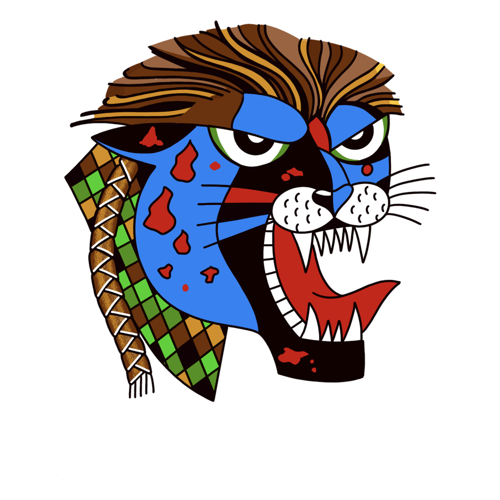

<p align="center">
  
</p>

# braveheart-branding

The logo of [Braveheart](https://github.com/Braveheart-Chess/braveheart), the
UCI chess engine, and the images made from it: the avatar, the favicons and the
social preview, with the scripts that make them. The engine repository holds
only the engine; its branding lives here.

> [!IMPORTANT]
> **The logo is not free to use.** The artwork is copyright © the artist and
> is used by this project under licence. It is **not** open source, and no
> rights to it are granted to anyone else. Forks and redistributions of
> Braveheart must leave it out. See [LICENSE](LICENSE).

## The logo

The Braveheart logo was drawn for this project by an artist commissioned by
the owner. The mascot is a snarling panther in William Wallace's colours: a
woad-blue face from the battle scenes of *Braveheart*, a braid and a tartan
scarf. The name joins the film to the Scotch Game, the aggressive opening
Scotland lends to chess. There are two versions of the mark:

| Mark | File | Use it for |
| --- | --- | --- |
| Big (the main logo) | [`logo.png`](logo.png) | Anywhere with room for detail: the README, docs pages, a site header. |
| Small (simplified) | [`logo-small.png`](logo-small.png) | Small or low-detail spots: favicons, badges, icons under about 64 px. |

Use the big mark wherever it fits, and the small one only when size or detail
is limited.

## Files

| File | Size | Background | Purpose |
| --- | --- | --- | --- |
| `logo.png` | 1024×1024 | Transparent | Main logo; works in GitHub's light and dark themes. |
| `logo-small.png` | 512×512 | Transparent | Simplified mark. |
| `logo.svg`, `logo-small.svg` | Vector | Transparent | Both marks traced to flat-colour paths, for anywhere that wants an SVG (an IDE project icon, print, large sizes). |
| `avatar.png` | 1024×1024 | White | Profile pictures (GitHub org or user avatar, other sites); padded so a circular crop keeps the whole head. |
| `social-preview.png` | 1280×640 | White | GitHub repository social preview (the link card on Slack, X, Discord and so on). |
| `favicon-32.png`, `favicon-64.png`, `favicon-180.png` | 32, 64, 180 px | Transparent | Favicons and the Apple touch icon, from the small mark. |
| `original/` | 1206×1609 | White | The artist's original files, unchanged apart from the lowercase extension. |

## Linking to the images

Other Braveheart repositories link to a file on `main` by its path. The
engine's README shows the logo this way:

```text
https://raw.githubusercontent.com/Braveheart-Chess/braveheart-branding/main/logo.png
```

So the paths are a contract. Every file in the table keeps its name, its size
and (where it has one) its transparent background; `tools/check-assets.py`
checks all three in CI. Renaming, resizing or removing one is a breaking change,
committed as `feat!:` or `fix!:`. To link to a version that never changes, put
a release tag such as `v0.1.0` in place of `main`.

Linking from Braveheart's own pages is what the owner's licence covers. It is
not permission for anyone else to use the artwork; see [LICENSE](LICENSE).

## Regenerating the images

Every PNG is derived from `original/` by
[`scripts/make_logos.py`](scripts/make_logos.py): it makes the white
background transparent (only white connected to the image border, so the
eyes and teeth stay white), crops, centres on a square canvas and resizes. To
regenerate, from the repository root:

```sh
python3 -m venv .venv && .venv/bin/pip install pillow numpy scipy
.venv/bin/python scripts/make_logos.py original .
```

The social preview's title uses Arial Bold from macOS.

The SVGs are traced from the same originals by
[`scripts/make_svg.py`](scripts/make_svg.py). It snaps every pixel to the
artwork's own flat colours (nine in the big mark, eight in the small one) and
traces the result with [vtracer](https://github.com/visioncortex/vtracer), so
the braid's grain in the big mark becomes flat patches. `logo.svg` fills more
of its square than `logo.png` does: a four-pixel speck below the mark in the
original stretches the PNG's crop, and the trace drops it. To regenerate:

```sh
.venv/bin/pip install vtracer
.venv/bin/python scripts/make_svg.py original .
```

Build the venv with Python 3.12 for this: vtracer 0.6.15 crashed under
Python 3.15.

## Licence

The artwork is all rights reserved. The artist keeps the copyright, and the
project owner holds a licence to use the artwork, commercial use included.
Neither the licence nor any other right to the artwork passes to anyone who
uses, forks or redistributes this repository or the engine. The full terms are
in [LICENSE](LICENSE).

Everything that is not an image (the scripts, and the repository's
configuration and documentation) is MIT licensed; see
[LICENSE-CODE](LICENSE-CODE).

## Contributing

See [CONTRIBUTING.md](CONTRIBUTING.md); coding agents also read
[AGENTS.md](AGENTS.md).
